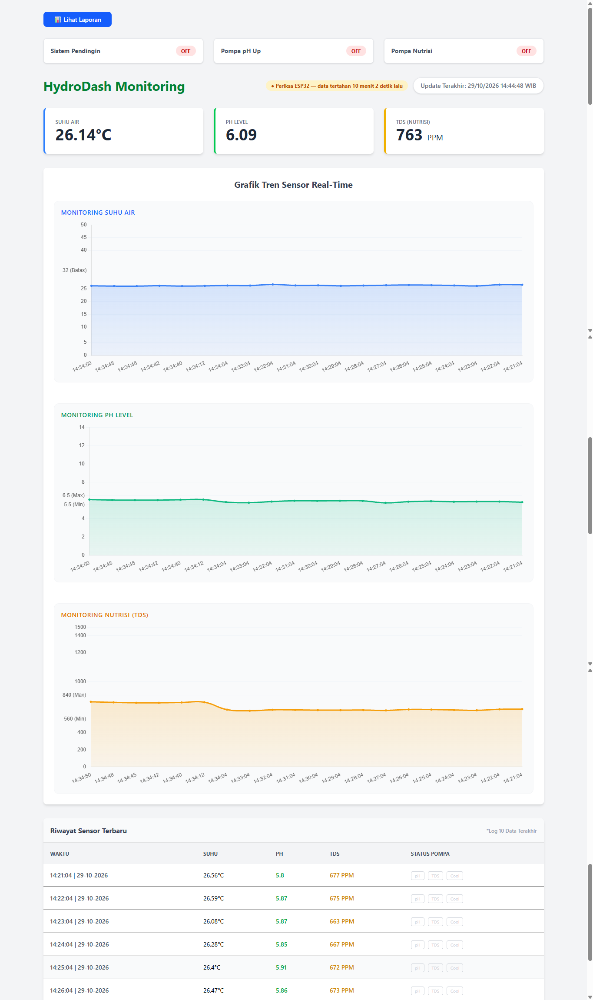
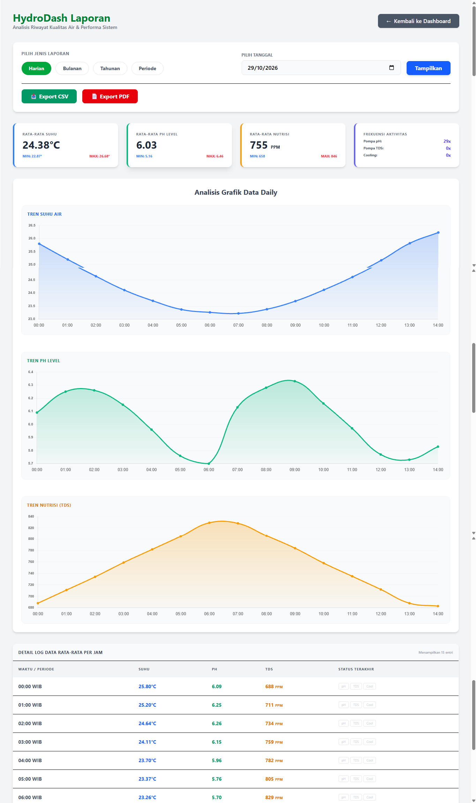
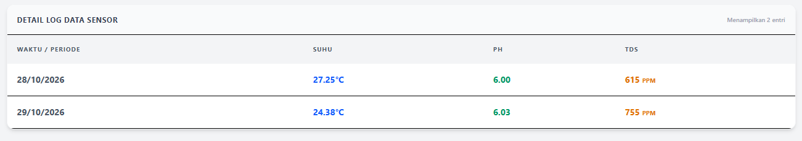

# HydroDash

## Preview

Tampilan aplikasi diambil langsung dari aplikasi yang sedang berjalan — datanya hasil **simulator perangkat** (lihat [bab 10](#10-simulator-perangkat-tanpa-hardware)).

### 🖥️ Dashboard Real-Time
Kartu status relay, indikator *data masuk / tertahan* (chip kuning membuktikan deteksi offline bekerja), tiga grafik Chart.js dengan garis ambang batas, dan log sensor terbaru.



### 📊 Laporan Harian
Empat kartu statistik (rata-rata, min/max, frekuensi aktivitas relay), tren suhu/pH/TDS antar-jam, dan tabel rata-rata per jam yang terpaginasi. Data bisa dieskspor ke CSV & PDF langsung dari halaman ini.



### 📋 Tabel Agregasi Periode
Gabungan data asli (Februari) dan data demo — isi tabel agregasi seperti ini juga yang dibenamkan ke laporan CSV/PDF.



## 1. Judul Proyek & Ringkasan
**HydroDash**
HydroDash merupakan sebuah sistem pemantauan kualitas/kuantitas air (dan hidroponik) yang menerima data pengukuran dari perangkat IoT (seperti ESP32) secara *real-time*. Sistem ini menyediakan sebuah dashboard interaktif dengan sistem pelaporan terpadu untuk kemudahan analisis dan ekstraksi data.

## 2. Teknologi yang Digunakan (Tech Stack)
- **Frontend**: Laravel Blade, Tailwind CSS 4, Axios, Vite
- **Backend**: PHP 8.2+, Laravel (v12), domPDF (barryvdh/laravel-dompdf)
- **Database & Storage**: SQLite / MySQL, penyimpanan file Laravel.
- **Perangkat Keras / IoT**: Integrasi sistem yang menerima data secara berkelanjutan (contoh dari mikrokontroler ESP32).

## 3. Fitur Utama & Logika Bisnis
- **Penerimaan Data IoT Masa Nyata (Real-Time Data)**: Kemampuan untuk menerima pembaruan data melalui *routes* API khusus (`/api/terima-data`).
- **Dashboard Terpusat**: Menampilkan data pengukuran terkini yang selalu diperbarui.
- **Sistem Laporan Terpadu (Unified Report System)**: Mampu memfilter dan melihat laporan berdasarkan kriteria: Harian, Bulanan, Tahunan, dan Periode kustom.
- **Export Informasi**: Memungkinkan data diekspor ke dalam format PDF (`/report/pdf`) dan format lain yang sesuai (`/report/export`).

## 4. Struktur Direktori Proyek
- `app/`: Menempatkan logika Controller (`DashboardController`, `ReportController`) dan pengelolaan Model aplikasi.
- `routes/`: Berisi definisi *routes* seperti `web.php` untuk interaksi pengguna/ESP32, dan `api.php` untuk AJAX request (`/get-latest-hydro`).
- `resources/`: Berisi tampilan (Blade template) antarmuka dashboard serta laporan.
- `public/`: Direktori publik untuk memuat aset statis web.
- `database/`: File untuk manajemen database (migration, seeder).

## 5. Panduan Instalasi & Cara Menjalankan Proyek
Instruksi untuk menjalankan aplikasi di server lokal:

1. **Instalasi *Dependencies***:
   ```bash
   composer install
   npm install
   ```
2. **Environment Variables**:
   Buat salinan konfigurasi dan tetapkan koneksi database:
   ```bash
   cp .env.example .env
   ```
3. **Persiapan Database & Security Key**:
   ```bash
   php artisan key:generate
   php artisan migrate
   ```
4. **Jalankan *Development***:
   Buka dua terminal terpisah untuk menjalankan aplikasi:
   ```bash
   npm run dev     # mode pengembangan (build on-the-fly)
   php artisan serve
   ```
   Untuk rilis/produksi, jalankan `npm run build` sekali saja — hasil *build*
   disimpan di `public/build` dan dimuat lewat direktif `@vite`. Tailwind juga
   sudah tidak dilayani dari CDN.

## 6. Endpoint API / Skema Database
Daftar *routes* dan endpoint utama yang dapat diakses:
- **Inti/IoT**:
  - `GET /` : Halaman Dashboard
  - `POST /api/terima-data` : Endpoint satu-satunya bagi ESP32 untuk mengirimkan data sensor.
  - `GET /api/get-latest-hydro` : *Routes* AJAX untuk mengambil data terbaru secara otomatis.
  - Semua endpoint `/api/*` dilindungi *rate limit* 240 permintaan/menit per IP (`config/hydro.php` → `api_rate_limit`) — polling tiap 1 detik tetap jauh di bawah ambang, spam terkendali.
- **Laporan**:
  - `GET /report` : Menampilkan ringkasan data berdasarkan jenis laporan (type=daily/monthly/yearly).
  - `GET /report/export` : Meng-*export* data sebagai file (seperti CSV/Excel).
  - `GET /report/pdf` : Membuat (*generate*) dan mengunduh dokumen PDF laporan.

## 7. Autentikasi Perangkat IoT (ESP32)
Mulai fase hardening pertama, endpoint `POST /api/terima-data` **wajib mengirim device token**. Token diatur di file `.env`:

```env
IOT_DEVICE_TOKEN=
```

Contoh pengiriman data dari sketch ESP32 (Arduino):

```cpp
HTTPClient http;
http.begin(client, "http://hydrodash.test/api/terima-data"); // atau http://IP-SERVER/api/terima-data
http.addHeader("Content-Type", "application/x-www-form-urlencoded");
http.addHeader("X-Device-Token", "hd_TOKEN_ANDA");       // <-- WAJIB: token device

String payload =
    "ph=" + String(ph, 2) +
    "&tds=" + String(tds, 0) +
    "&suhu=" + String(suhu, 2) +
    "&status_pompa_ph=" + String(pompaPh ? "ON" : "OFF") +     // opsional
    "&status_pompa_tds=" + String(pompaTds ? "ON" : "OFF") +   // opsional
    "&status_pendingin=" + String(pendingin ? "ON" : "OFF");   // opsional

int code = http.POST(payload);
// 201 = data tersimpan, 401 = token salah/tidak ada, 400 = nilai tidak valid
http.end();
```

Alternatif tanpa header: tambahkan `&token=hd_TOKEN_ANDA` ke payload. Batas validasi: `ph` 0–14, `tds` 0–5000 PPM, `suhu` −10–60 °C; field `status_*` hanya menerima `ON`/`OFF`. Setelah mengubah `IOT_DEVICE_TOKEN`, jalankan `php artisan config:clear`.

## 8. Pemeliharaan Data (Prune Otomatis)
Data sensor bertumbuh terus (±6 juta baris/tahun bila dikirim tiap 5 detik). Perintah `sensors:prune` menghapus data yang lebih tua dari batas retensi (`config/hydro.php` → `prune.retention_days`, default 365 hari):

```bash
php artisan sensors:prune            # pakai default config
php artisan sensors:prune --days=90  # batas retensi kustom
```

Jadwal otomatis (harian pukul 03:00) sudah terdaftar di `routes/console.php`. Di Windows, jadwal Laravel butuh salah satu dari:

```bash
php artisan schedule:work    # proses background; jalankan saat development
```

atau daftarkan **Task Scheduler** (setiap menit) yang mengeksekusi `php artisan schedule:run` di folder proyek:

```powershell
schtasks /Create /TN "HydroDash-Sched" /SC MINUTE /TR "php C:\laragon\www\HydroDash\artisan schedule:run" /F
```

Untuk memantau kesehatan data (jumlah baris, rentang waktu, usia data terkini, ukuran tabel, sisa data yang akan terprune):

```bash
php artisan sensors:stats
```

Setelah mengubah `IOT_DEVICE_TOKEN`, jalankan `php artisan config:clear`.

## 9. Uji Otomatis (php artisan test)
Proyek ini sudah punya rangkaian uji fitur berbasis PHPUnit — dijalankan di **sqlite in-memory**, jadi MySQL/database asli sepenuhnya aman:

```bash
php artisan test
```

Cakupan uji (`tests/Feature/`):
- **IngestTest** — token wajib (401 tanpa/berbeda token), mekanisme *fail-closed* saat config token kosong, penerimaan via header `X-Device-Token` dan field `token`, pesan validasi tetap berbahasa Indonesia (kontrak 400 untuk ESP32), fallback status relay dari threshold config, dan prioritas status kiriman ESP32.
- **ApiThrottleTest** — *rate limit* API aktif dan ambangnya dikendalikan `hydro.api_rate_limit`.
- **PruneCommandTest** — menolak `--days` < 1 dan penghapusan baris lama bersifat idempoten.
- **ReportTest** — keempat jenis laporan tampil, laporan kosong tertangani rapi, export CSV berisikan header kolom yang benar, dan PDF berhasil dihasilkan.
- **ExampleTest** — halaman dashboard merespons 200 dengan database kosong sekalipun.

Agregasi SQL laporan ditulis portabel untuk MySQL **dan** sqlite (`HOUR()`/`MONTH()` di MySQL, `strftime('%H')`/`strftime('%m')` di sqlite), sehingga uji bisa berjalan di keduanya.

## 10. Simulator Perangkat (Tanpa Hardware)
Belum punya rangkaian ESP32? Proyek ini menyertakan simulator CLI (`tools/simulator_esp32.php`) yang meniru perilaku sketch ESP32 dengan kontrak identik: kirim `POST /api/terima-data` tiap ±5 detik memakai device token dari `.env`. Kelak saat rangkaian asli tersedia, sketch cukup menggantikan simulator tanpa perubahan apa pun di server.

```bash
# Tanam riwayat 24 jam terakhir (sekali jalan) agar grafik & laporan langsung terisi
php tools/simulator_esp32.php --backfill=24

# Mode live — kirim tiap 5 detik sampai Ctrl+C (chip dashboard jadi hijau)
php tools/simulator_esp32.php

# Batas siklus (praktis untuk pengujian cepat)
php tools/simulator_esp32.php --cycles=5
```

Opsi lainnya: `--url=http://alamat:port` untuk menunjuk server lain dan `--interval=5` untuk mengatur jeda kirim.

Nilai yang dibuat realistis: pH berayun dekat area ideal, TDS turun lalu refill (560–840 PPM), suhu mengikuti siklus harian, plus episode acak kecil (pH drop, TDS drop, gelombang panas) sehingga status pompa/pendingin sesekali berubah ON sesuai logika threshold — sama seperti perangkat nyata.

**Membersihkan data demo** bila ingin database kembali bersih (ganti tanggal sesuai mulai demo):

```bash
php artisan tinker --execute="DB::table('sensor_data')->where('created_at','>=','2026-10-29 00:00:00')->delete();"
```

Pantau kesehatan data kapan pun dengan `php artisan sensors:stats`.
